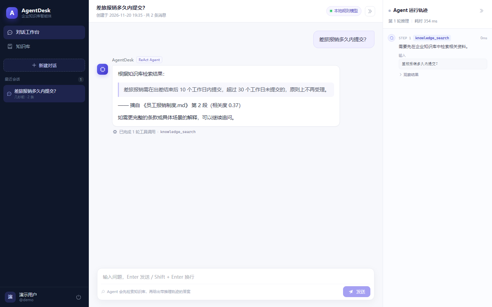
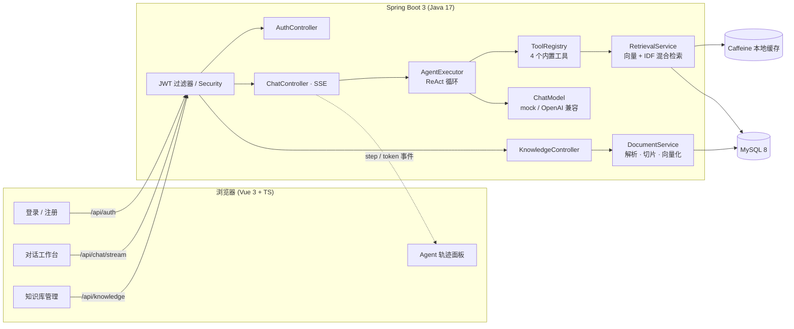
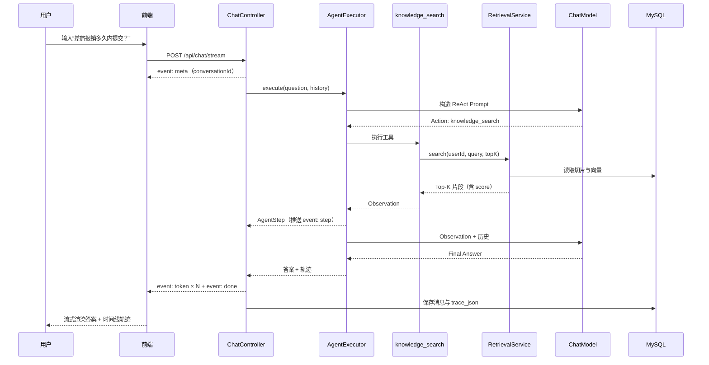

# AgentDesk · 企业知识库智能体工作台

> Java 17 + Spring Boot 3 + Vue 3 全栈项目，内置**自研 ReAct Agent**：上传文档 → 切片向量化 → 混合检索 → 工具调用 → SSE 流式回答，并把每一步推理轨迹展示给用户。

<p>
  
  
  
  
  
  
  
</p>



## 这个项目解决什么问题

企业里的制度、手册、会议纪要散落在各个文档中，新人问一句“差旅报销多久内提交”，往往要翻半天文件。AgentDesk 把这些文档变成可对话的知识库：

- 用户上传 `txt / md / pdf`，系统自动解析、切片、向量化；
- 提问时 Agent 先检索知识库，再决定是否调用计算器、时间等工具；
- 回答带**出处引用**，右侧同步展示 Thought / Tool / Observation 的完整推理轨迹，答案可解释、可追溯；
- 没有大模型 API Key 也能跑：内置本地向量模型 + 规则模型，克隆即用；配置 `LLM_MODE=openai` 可切到 DeepSeek / 通义 / OpenAI。

> 面向 **Java 全栈开发** 与 **Agent 开发** 岗位设计：既有完整的 Web 工程（鉴权、分层、事务、异常、流式接口、前端工程化），也有 Agent 的核心能力（工具注册、ReAct 循环、RAG、轨迹可观测）。

## 功能特性

| 模块 | 能力 |
| --- | --- |
| 知识库 | 拖拽上传 txt/md/pdf，PDFBox 解析；按句子边界切片（320 字 / 重叠 60 字）；切片向量化落库；文档级联删除 |
| RAG 检索 | 384 维本地哈希向量 + 关键词 IDF 加权混合排序；Top-K 召回；Caffeine 缓存 5 分钟；检索测试抽屉可视化 score |
| ReAct Agent | 自研执行器：最多 5 轮推理，工具注册表、Prompt 构造、Observation 回填、重复调用熔断、异常降级 |
| 内置工具 | `knowledge_search` 知识库检索、`calculator` 表达式计算、`current_time` 当前时间、`knowledge_stats` 知识库统计 |
| 对话 | 多会话管理、历史上下文（最近 6 条）、消息与推理轨迹持久化、Markdown 渲染 |
| 流式输出 | `POST /api/chat/stream` SSE：`meta / step / token / done / error` 五类事件，前端边推理边展示 |
| 账号安全 | Spring Security + JWT（HS256）、BCrypt 密码、统一 401/403、多用户数据隔离 |
| 工程化 | 统一响应体、全局异常处理、参数校验、Swagger UI、Maven Wrapper、Docker Compose、一键打包脚本 |

## 技术栈

**后端**：Java 17 · Spring Boot 3.3 · Spring Security · MyBatis-Plus 3.5 · MySQL 8 · JWT (jjwt) · Caffeine · Apache PDFBox · springdoc-openapi · JUnit 5 + Mockito + AssertJ

**前端**：Vue 3.5 · TypeScript · Vite 5 · Pinia · Vue Router · Element Plus · marked + DOMPurify · axios

**工具链**：Maven Wrapper · npm · Git · Docker Compose（可选 MySQL）· Windows / macOS / Linux 均可运行

## 系统架构



### 一次对话的时序



## 快速开始

### 1. 环境要求

| 依赖 | 版本 | 说明 |
| --- | --- | --- |
| JDK | 17+ | `java -version` 确认 |
| MySQL | 8.0+ | 本地安装或用 `docker compose up -d` |
| Node.js | 18+（推荐 20/22） | 仅前端开发/打包需要 |
| Maven | 无需安装 | 仓库自带 `mvnw` / `mvnw.cmd` |

### 2. 创建数据库

```sql
CREATE DATABASE agentdesk DEFAULT CHARACTER SET utf8mb4 COLLATE utf8mb4_0900_ai_ci;
CREATE USER 'agentdesk'@'localhost' IDENTIFIED BY 'agentdesk123';
GRANT ALL PRIVILEGES ON agentdesk.* TO 'agentdesk'@'localhost';
FLUSH PRIVILEGES;
```

表结构在应用启动时由 `src/main/resources/db/schema.sql` 自动创建，**无需手动执行 DDL**。

也可以直接用 Docker：

```bash
docker compose up -d mysql
```

### 3. 启动后端

**方式 A：IDEA（推荐）**

1. `File → Open` 选择项目根目录，等待 Maven 依赖下载完成；
2. 确认 `Project SDK = 17`、`Maven → Runner → JRE = 17`；
3. 运行 `com.agentdesk.AgentDeskApplication`；
4. 控制台出现 `Started AgentDeskApplication` 后访问 <http://localhost:8080>。

**方式 B：命令行**

```bash
# Windows
mvnw.cmd spring-boot:run
# macOS / Linux
./mvnw spring-boot:run
```

首次启动会自动创建演示账号并导入 3 份示例文档（`员工报销制度`、`产品技术架构说明`、`新员工入职指南`），可通过 `agentdesk.demo.enabled=false` 关闭。

### 4. 前端开发模式（可选）

后端已内置打包好的前端页面，直接访问 8080 即可。需要改前端时：

```bash
cd frontend
npm install
npm run dev      # http://localhost:5173，/api 已代理到 8080
```

### 5. 打包成单个 Jar

```bash
# Windows
pwsh scripts/build.ps1
# 或手动
cd frontend && npm run build
# 将 frontend/dist/* 复制到 src/main/resources/static/
mvnw.cmd -DskipTests package
java -jar target/agentdesk.jar
```

### 6. 切换真实大模型（可选）

```bash
# Windows PowerShell
$env:LLM_MODE="openai"
$env:LLM_BASE_URL="https://api.deepseek.com/v1"
$env:LLM_API_KEY="sk-xxxx"
$env:LLM_MODEL="deepseek-chat"
mvnw.cmd spring-boot:run
```

> 不配置 Key 时使用内置 `mock` 模型：它不是“假接口”，而是一个可解释的规则决策器，会真实走完工具调用与 Observation 回填，用于离线演示与 CI。

## 演示账号

| 账号 | 密码 |
| --- | --- |
| `demo` | `123456` |

可以这样问：

- 差旅报销多久内提交？
- 新员工入职需要准备哪些材料？
- 知识库里有多少文档？
- 128*3+45 等于多少？
- 现在几点了？

## API 一览

完整契约见 [docs/api.md](docs/api.md)，启动后访问 <http://localhost:8080/swagger-ui.html> 可在线调试。

| 方法 | 路径 | 说明 |
| --- | --- | --- |
| POST | `/api/auth/register` | 注册并自动登录 |
| POST | `/api/auth/login` | 登录，返回 JWT |
| GET | `/api/auth/me` | 当前用户 |
| GET | `/api/knowledge/documents` | 文档列表 |
| POST | `/api/knowledge/documents` | 上传文档（multipart `file`） |
| DELETE | `/api/knowledge/documents/{id}` | 删除文档及切片 |
| GET | `/api/knowledge/stats` | 文档数 / 切片数 / 总字数 |
| POST | `/api/knowledge/search` | 检索测试，返回 score |
| GET | `/api/chat/conversations` | 会话列表 |
| POST | `/api/chat/conversations` | 新建会话 |
| DELETE | `/api/chat/conversations/{id}` | 删除会话 |
| GET | `/api/chat/conversations/{id}/messages` | 消息 + 推理轨迹 |
| POST | `/api/chat/stream` | SSE 流式对话 |

SSE 事件：`meta`（会话 id）→ `step`（工具调用）→ `token`（增量文本）→ `done`（完整答案与耗时），异常时为 `error`。

## 项目结构

```
agentdesk/
├── src/main/java/com/agentdesk/
│   ├── agent/                 # ReAct 执行器、工具接口与实现
│   │   ├── AgentExecutor.java # 推理循环 / Prompt 构造 / 死循环保护
│   │   └── tools/             # knowledge_search、calculator、current_time、knowledge_stats
│   ├── chat/                  # 会话、消息、SSE 编排
│   ├── knowledge/             # 文档解析、切片、入库
│   ├── retrieval/             # 向量 + 关键词混合检索
│   ├── embedding/             # 向量模型抽象、哈希向量、余弦计算
│   ├── llm/                   # ChatModel：mock 规则模型 / OpenAI 兼容客户端
│   ├── security/              # JWT、Security 配置、当前用户
│   ├── user/                  # 注册登录
│   ├── config/                # 配置属性、Swagger、SPA 路由
│   ├── common/                # 统一响应、业务异常、全局异常处理
│   └── init/                  # 演示数据初始化
├── src/main/resources/
│   ├── application.yml
│   ├── db/schema.sql
│   └── demo-docs/             # 3 份示例文档
├── src/test/java/             # 39 个单元测试
├── frontend/                  # Vue 3 + TS + Element Plus
├── docs/                      # 接口契约、架构说明、简历文案、截图
├── scripts/                   # 一键构建 / 启动脚本
└── docker-compose.yml
```

## 核心设计

### 1. 为什么自研 Agent 执行器

框架（LangChain4j、Spring AI）能快速起步，但面试与真实业务更关心“你是否理解 Agent 的运行机制”。这里把四件事显式实现：

- **工具注册**：实现 `Tool` 接口并注册为 Spring Bean，`ToolRegistry` 自动发现，按名称路由；
- **推理循环**：Prompt 中给出工具清单与 ReAct 格式约束，解析 `Thought / Action / Action Input / Final Answer`；
- **观测回填**：工具返回值作为 `Observation` 写回下一轮 Prompt，异常也转成 Observation，单次工具失败不会中断对话；
- **熔断保护**：最多 5 轮；连续两轮相同工具 + 相同入参时提前终止，避免模型死循环。

### 2. RAG 链路

```
上传 → 解析（PDFBox）→ 句子级切片（320 字 / 重叠 60）→ 384 维哈希向量 → MySQL
提问 → 向量化 → 余弦相似度 + 关键词 IDF 覆盖率加权（0.65 : 0.35）→ Top-4 → 注入 Prompt
```

- 切片优先按句号、问号、分号断开，超长句子硬切，保证语义完整且长度可控；
- 文档名参与向量化，提升“按文档名提问”的召回；
- 检索结果进 Caffeine 缓存（5 分钟 / 500 条），重复提问不再重复计算；
- 向量存 `TEXT` 字段、内存中计算余弦，万级切片内足够快；数据量上来后可平滑替换为 pgvector / Milvus，接口不变。

### 3. 可观测性

每条助手消息都会持久化 `trace_json`，包含每一步的 thought、tool、input、observation、latency。前端右侧时间线实时渲染，刷新页面后历史会话依然能看到当时的推理过程——这是 Agent 应用区别于普通 Chatbot 的关键。

### 4. 降级策略

| 场景 | 处理 |
| --- | --- |
| 无大模型 Key | 使用 `mock` 规则模型，完整走通 Agent 流程 |
| 工具执行异常 | 捕获后作为 Observation 回填，由模型决定下一步 |
| 模型输出格式错误 | 无 `Action` 时按普通回答返回，不抛 500 |
| 知识库为空 | 明确告知“未检索到”，引导上传文档，不编造 |
| SSE 客户端断开 | 服务端捕获异常并结束 emitter，不占用线程 |

## 测试

```bash
mvnw.cmd test        # 39 个测试
```

覆盖：ReAct 循环（工具调用、直接回答、异常降级、死循环熔断）、表达式求值、切片边界与重叠、向量归一化与相似度、混合检索排序、JWT 签发/篡改、注册登录校验。全部通过，无外部依赖（不依赖数据库与网络）。

## 简历怎么写

见 [docs/resume.md](docs/resume.md)：包含项目一句话介绍、可直接粘贴的简历条目、2 分钟讲解稿、20 道高频追问与参考回答，以及如何把“39 个测试”“Top-K 命中率”等指标换成你自己的实测数据。

## 后续规划

- [ ] 文档异步解析（消息队列）+ 解析进度推送
- [ ] 会话记忆摘要（长对话压缩），支持多轮追问指代
- [ ] 工具权限与调用审计，支持租户隔离
- [ ] pgvector / Milvus 向量库适配
- [ ] Docker 镜像与 GitHub Actions CI

## License

[MIT](LICENSE)
