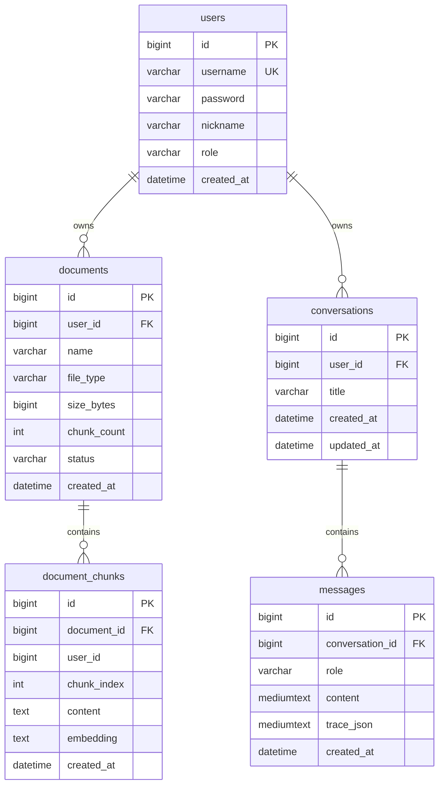

# AgentDesk 架构说明

## 1. 目标与非目标

**目标**

- 一个能完整跑通的「知识库 + Agent」闭环：上传、检索、工具调用、流式回答、推理轨迹回放。
- 用 Java 生态实现，展示 Spring Boot 分层、安全、事务、流式接口等全栈能力。
- 零外部依赖也能演示：不配置大模型 Key、不装向量库、不装 Redis。

**非目标（有意取舍）**

- 不做多租户 / RBAC 权限体系，只做用户级数据隔离。
- 不做分布式部署与消息队列，文档解析同步执行。
- 不追求大规模检索性能，万级切片以内以简单可靠优先。

## 2. 模块职责

| 包 | 职责 | 关键类 |
| --- | --- | --- |
| `common` | 统一响应体、业务异常、全局异常处理 | `ApiResponse`、`BizException`、`GlobalExceptionHandler` |
| `config` | 配置属性、Swagger、SPA 路由转发 | `AppProperties`、`OpenApiConfig`、`SpaForwardController` |
| `security` | JWT 签发/校验、Security 过滤链、当前用户 | `JwtTokenProvider`、`JwtAuthenticationFilter`、`SecurityConfig` |
| `user` | 注册、登录、当前用户 | `UserService`、`AuthController` |
| `knowledge` | 文档解析、切片、入库、统计、检索测试 | `DocumentService`、`DocumentParser`、`TextChunker` |
| `embedding` | 向量模型抽象与本地实现 | `EmbeddingModel`、`HashingEmbeddingModel`、`VectorUtils` |
| `retrieval` | 向量 + 关键词混合检索、缓存 | `RetrievalService` |
| `llm` | 模型抽象：规则模型 / OpenAI 兼容客户端 | `ChatModel`、`MockChatModel`、`OpenAiChatModel` |
| `agent` | ReAct 执行器、工具协议与实现 | `AgentExecutor`、`ToolRegistry`、`Tool` |
| `chat` | 会话、消息、SSE 编排 | `ChatService`、`ChatController` |
| `init` | 演示账号与示例文档初始化 | `DemoDataInitializer` |

依赖方向：`chat → agent → retrieval → embedding/knowledge`，`llm` 与 `embedding` 均为接口，业务层不依赖具体实现。

## 3. 数据模型



索引策略：

- `users.username` 唯一索引，登录查询；
- `documents.user_id`、`document_chunks.user_id` / `document_id`，按用户隔离与级联删除；
- `conversations.user_id`，会话列表按 `updated_at` 倒序；
- `messages.conversation_id`，按会话加载消息。

`embedding` 存逗号分隔的 384 个 float（约 3KB/条），读取后反序列化为 `float[]` 在内存中计算余弦。数据量增大后可迁移为 `BLOB` 或向量库。

## 4. 关键流程

### 4.1 文档入库

```
MultipartFile
  → 校验（非空 / ≤10MB / txt|md|pdf）
  → DocumentParser：txt/md 按 UTF-8；pdf 用 PDFBox 抽取文本（上限 20 万字）
  → TextChunker：按 [。！？!?；;] 切句 → 贪心拼接到 320 字 → 相邻保留 60 字重叠 → 超长句硬切
  → 每条切片：embedding = hash(name + "\n" + content)
  → 落库 documents + document_chunks（同一事务）
```

选择“文档名参与向量化”是为了让“报销制度里怎么说的”这类按文档名提问也能召回。

### 4.2 检索打分

```
score = 0.65 × max(cosine(q, chunk), 0) + 0.35 × keywordScore
keywordScore = Σ idf(命中词) / Σ idf(查询词) + 完全匹配加成(0.05)
idf(t) = ln(1 + N / (1 + df(t)))
```

- 查询词由 `TextTokenizer` 产生：英文按单词，中文按「单字 + 二元组」；
- 用 IDF 而不是简单命中率，避免“的、是、在”这类高频词拉高分数；
- 结果按 score 倒序取 Top-K（默认 4），低于 `min-score` 丢弃；
- 结果缓存到 Caffeine（key = userId + topK + query，5 分钟过期）。

### 4.3 Agent 循环

```java
for (round = 1; round <= maxSteps; round++) {
    prompt = system + tools + history + question + scratchpad;
    output = chatModel.chat(prompt);
    if (output 含 "Final Answer:") return answer;
    action = parse("Action:");
    input  = parse("Action Input:");
    if (action 为空) return output;                  // 模型直接回答
    observation = tools.execute(action, input);       // 异常 → "工具执行失败：..."
    steps.add(new AgentStep(thought, action, input, observation, latency));
    scratchpad += action + observation;
    if (连续两轮 tool+input 相同) break;              // 熔断
}
return 兜底答案（附最后一次 observation）
```

Prompt 中明确约束：涉及制度/产品/流程必须先调 `knowledge_search`，计算必须调 `calculator`，最多 N 轮，Final Answer 用中文并引用文档名。

### 4.4 SSE 生命周期

```
POST /api/chat/stream
  → Controller 创建 SseEmitter(180s)，交给 agentExecutorPool
  → 请求线程立即返回，Tomcat 线程释放
  → 工作线程：
      1. 解析/创建会话，保存用户消息
      2. event: meta   { conversationId, userMessageId }
      3. Agent 推理；每完成一步 event: step { ...AgentStep }
      4. 保存助手消息（trace_json），按 6 个字符分片推送 event: token
      5. event: done   { messageId, answer, durationMs, stepCount }
  → 异常：event: error { message }
  → 客户端断开：send 抛 IOException，服务端结束 emitter
```

`done` 之后再刷新会话列表，保证标题和消息数已落库。

## 5. 并发与线程模型

- Tomcat 默认 200 线程，SSE 请求不长期占用；
- `agentExecutorPool` 固定 8 线程，队列无界（演示规模足够）；生产应换成有界队列 + 拒绝策略；
- `SseEmitter` 超时 180s，`onTimeout/onError` 都会 `complete()`；
- MySQL Hikari 连接池 10，SSE 工作线程中的写库是短事务；
- 检索使用 Caffeine 本地缓存，线程安全，无跨节点一致性要求。

## 6. 安全模型

- 登录：用户名 + BCrypt 密码校验，签发 HS256 JWT（默认 7 天）；
- 鉴权：`JwtAuthenticationFilter` 解析 `Authorization: Bearer`，写入 `SecurityContext`；
- 授权：业务层按 `user_id` 过滤；删除/查询前校验资源归属，越权统一返回 404；
- 密码与密钥：`JWT_SECRET` 支持环境变量覆盖，密钥长度 < 32 字节时启动失败；
- 文件上传：扩展名白名单 + 大小限制 + 解析文本长度上限，避免超大文件打爆内存；
- XSS：前端 Markdown 渲染前用 DOMPurify 消毒，外链加 `noopener noreferrer`。

## 7. 配置项

| 配置 | 默认值 | 说明 |
| --- | --- | --- |
| `agentdesk.jwt.secret` | 本地开发密钥 | 生产必须用环境变量覆盖 |
| `agentdesk.jwt.expire-hours` | 168 | Token 有效期 |
| `agentdesk.llm.mode` | `mock` | `mock` / `openai` |
| `agentdesk.llm.base-url` | `https://api.deepseek.com/v1` | OpenAI 兼容地址 |
| `agentdesk.llm.model` | `deepseek-chat` | 模型名 |
| `agentdesk.agent.max-steps` | 5 | 最大推理轮数 |
| `agentdesk.agent.history-size` | 6 | 带入 Prompt 的历史消息数 |
| `agentdesk.rag.chunk-size` | 320 | 切片长度 |
| `agentdesk.rag.chunk-overlap` | 60 | 切片重叠 |
| `agentdesk.rag.top-k` | 4 | 召回条数 |
| `agentdesk.rag.min-score` | 0.08 | 最低相关度 |
| `agentdesk.rag.keyword-weight` | 0.35 | 关键词权重 |
| `agentdesk.demo.enabled` | true | 是否初始化演示数据 |

## 8. 设计取舍

| 决策 | 选择 | 原因 | 代价 |
| --- | --- | --- | --- |
| Agent 框架 | 自研 | 展示对 ReAct 机制的理解，便于定制与测试 | 没有框架的生态与高级能力 |
| 向量存储 | MySQL TEXT + 内存余弦 | 零额外中间件，克隆即跑 | 万级以上切片性能下降 |
| Embedding | 本地哈希 | 离线可用、无成本、可复现 | 语义表达能力弱于 BGE/OpenAI |
| 流式协议 | SSE | 单向推送、HTTP 语义、易鉴权 | 不支持双向通信 |
| 文档解析 | 同步 | 实现简单、状态一致 | 大文件阻塞请求 |
| 会话记忆 | 最近 N 条 | 简单可控 | 长对话丢失早期上下文 |

## 9. 演进路线

1. **异步解析**：上传后写 `status=PROCESSING`，解析任务投递到队列，前端轮询/SSE 推送进度。
2. **向量库**：抽象 `VectorStore` 接口，提供 pgvector 实现，检索从全表扫描变为 ANN。
3. **真实 Embedding**：增加 `OpenAiEmbeddingModel`，用配置切换，重建索引接口。
4. **记忆压缩**：超过 N 轮后调用模型生成摘要，保留关键实体与结论。
5. **评测体系**：固定 20~50 题评测集，统计 Top-K 命中率、答案引用准确率，作为回归测试。
6. **可观测性**：接入 Micrometer + Prometheus，记录工具耗时、检索耗时、Token 消耗。

## 10. 排查手册

| 现象 | 可能原因 | 处理 |
| --- | --- | --- |
| 启动报 `Access denied` | 数据库账号/密码不对 | 检查 `DB_USERNAME` / `DB_PASSWORD`，确认已授权 |
| 登录 401 | Token 过期或密钥变更 | 重新登录；确认 `JWT_SECRET` 未变 |
| 回答“未检索到” | 知识库为空或问题与文档无关 | 上传文档；用检索测试页确认 Top-K |
| SSE 无输出 | 反向代理缓冲了响应 | Nginx 关闭 `proxy_buffering`，加 `X-Accel-Buffering: no` |
| PDF 解析为空 | 扫描件无文字层 | 需要 OCR，当前版本不支持 |
| `mvn` 命令找不到 | 未安装 Maven | 用仓库自带 `mvnw` / `mvnw.cmd` |
